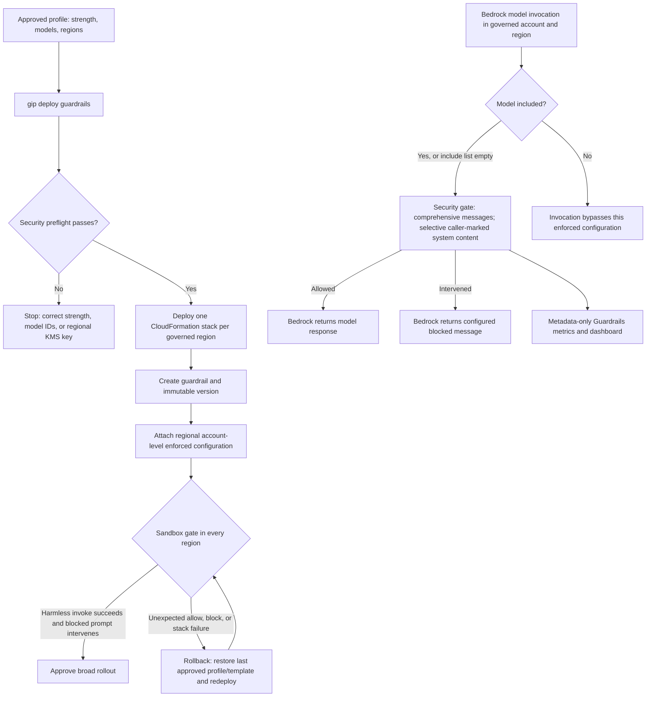

# Bedrock Guardrails Enforcement

This optional stack applies Amazon Bedrock Guardrails at the account-and-region level for the inference account.

> **How does this relate to per-user controls?** The Bedrock service enforces the guardrail on every **in-scope model invocation** in the account and region; an empty `model_include_list` means all models. Messages are guarded comprehensively while system prompts use selective guarding. This policy is not per-user, and an in-scope client cannot opt out. For the didactic end-to-end explanation, see [How the Controls Actually Work](HOW_IT_WORKS.md#door-3-what-the-model-will-say-bedrock-guardrails).

## What It Deploys

- `deployment/infrastructure/guardrails-enforcement.yaml`
- One regional CloudFormation stack per configured Bedrock region.
- An `AWS::Bedrock::Guardrail` with harmful-content filters enabled for input and output. The default does not add a `PROMPT_ATTACK` filter.
- An immutable `AWS::Bedrock::GuardrailVersion`.
- An `AWS::Bedrock::EnforcedGuardrailConfiguration` using `Messages: COMPREHENSIVE` and `System: SELECTIVE` for Claude Code compatibility.
- A CloudWatch dashboard using metadata-only `AWS/Bedrock/Guardrails` metrics.

## Enable

Interactive:

```bash
gip init
gip deploy guardrails
```

Answers-file fields:

```yaml
guardrails:
  enabled: true
  content_filter_strength: MEDIUM  # LOW | MEDIUM | HIGH
  safeguard_tier: CLASSIC          # CLASSIC (default) | STANDARD, see "Safeguard tier"
  name: gip-guardrail             # optional
  model_include_list: []           # empty = all models in the account+region
  kms_key_arn: null                # optional CMK for guardrail configuration
```

Profile JSON fields:

```json
{
  "guardrails_enabled": true,
  "guardrails_content_filter_strength": "MEDIUM",
  "guardrails_safeguard_tier": "CLASSIC",
  "guardrails_name": "gip-guardrail",
  "guardrails_model_include_list": [],
  "guardrails_kms_key_arn": null
}
```

## Operating Model



- Enforcement is regional. The CLI deploys the stack to every `allowed_bedrock_regions` entry in the same AWS partition as the profile region.
- If `allowed_bedrock_regions` is empty, guardrails uses the same all-known-Bedrock-region fallback as the auth stack to avoid leaving an IAM-allowed region unenforced.
- `guardrails_kms_key_arn` is only supported for a single-region guardrails deployment, and the key ARN must be in that region.
- Empty `model_include_list` puts every Bedrock model in that account and region in scope (for OpenAI models on the Responses API, see the note at the end of this list). Use a dedicated inference account when possible.
- If you co-host unrelated Bedrock workloads, set `model_include_list` to the model IDs this deployment should govern. Use foundation-model IDs such as `anthropic.claude-haiku-4-5-20251001-v1:0`: the enforced configuration rejects cross-Region inference profile IDs (`us.anthropic...`), and a foundation-model entry also covers calls made through geographic cross-Region inference profiles (verified for `us.` with Claude Haiku 4.5). `gip init --from-file` and `gip deploy guardrails` check the format.
- Guardrail trace is not enabled by this stack. Do not enable trace for production traffic unless the response and logs are treated as sensitive data.
- `PolicyRevision` forces CloudFormation to roll out a new immutable guardrail version when policy behavior changes.
- Governed roles include `bedrock:ApplyGuardrail`, required to apply the enforced guardrail during inference.
- Mantle (`bedrock-mantle`) endpoint coverage remains unverified and is blocked separately by the `DenyBedrockMantleEndpoint` IAM policy until metering/governance parity exists (for IAM Identity Center users the permission set has to carry that deny; see the [setup guide](providers/iam-identity-center-setup.md#chatgpt-work-and-codex-openai-models)). OpenAI models on the bedrock-runtime endpoint (`AllowOpenAIModels=true`, [ADR-0037](adr/0037-openai-models-on-bedrock-runtime.md)) are not blocked. Whether account-level enforced guardrails apply to their Responses API calls has not been verified, and the model cards list Guardrails support per model and API (for example, GPT-6.1 Sol does not support Guardrails with Responses). Any Mantle use outside governed paths is surfaced by the metering stack's `MantleEndpointUsageAlarm` tripwire — see [ADR-0022](adr/0022-mantle-metering-deferred-tripwire.md) and [QUOTA_MONITORING.md](QUOTA_MONITORING.md#endpoint-scope-bedrock-runtime-only-mantle-tripwire).

## Safeguard tier

The content filters run on the Classic tier unless you opt in to the Standard tier (`safeguard_tier: STANDARD`, or the tier question in `gip init`). Classic is the default, and a profile without the setting deploys exactly the guardrail it did before.

- **What Standard adds.** More robust content filtering, broader language support (Classic supports English, French and Spanish), and better handling of code-related prompts and responses ([safeguard tiers](https://docs.aws.amazon.com/bedrock/latest/userguide/guardrails-tiers.html)).
- **Cross-Region evaluation.** Standard tier requires cross-Region guardrail inference through a system-defined guardrail profile. The guardrail configuration stays in its Region, but prompts and responses can be evaluated in other Regions of the profile's geography ([cross-Region guardrail inference](https://docs.aws.amazon.com/bedrock/latest/userguide/guardrails-cross-region.html)). Review this against your data-residency requirements before you opt in. For a data-residency profile (`cross_region_profile` `au`, `eu`, `jp` or `us-gov`), a guardrails Region uses Standard only when every destination of its guardrail profile stays inside the geography the model routing stays in; otherwise that Region stays on Classic. For example, with `au` and the default Regions, ap-southeast-2 uses `au.guardrail.v1:0` and ap-southeast-4, whose only profile is `apac.guardrail.v1:0`, stays on Classic.
- **Profile per Region.** `gip deploy guardrails` picks the guardrail profile for each guardrails Region from the AWS table of [supported Regions](https://docs.aws.amazon.com/bedrock/latest/userguide/guardrails-cross-region-support.html), for example `us.guardrail.v1:0` in the US Regions, `eu.guardrail.v1:0` in eu-central-1 or eu-west-1, `uk.guardrail.v1:0` in eu-west-2 and `au.guardrail.v1:0` in ap-southeast-2 (which keeps evaluation in Australia). A guardrails Region without a guardrail profile, such as ca-west-1 in the default US Region list, stays on Classic and gets exactly the guardrail a Classic profile deploys. Before it deploys, `gip deploy guardrails` (and `--show-commands`) prints a table of each Region's tier, guardrail profile and destination Regions, with the reason each Classic Region fell back. It stops before deploying anything when no guardrails Region can use Standard, and `gip init --from-file` rejects the same answers. Standard tier also needs an explicit `allowed_bedrock_regions` list.
- **IAM.** Callers need `bedrock:ApplyGuardrail` on the guardrail profile in each destination Region as well as on the guardrail ([permissions](https://docs.aws.amazon.com/bedrock/latest/userguide/guardrail-profiles-permissions.html)). The governed roles allow `guardrail-profile/*` in the account alongside `guardrail/*`, under the same `aws:RequestedRegion` condition, so redeploy the auth stack (`gip deploy auth`) before you deploy a Standard-tier guardrail. Without the guardrail-profile grant, every in-scope invocation fails with `AccessDeniedException` on `bedrock:ApplyGuardrail`, so `gip deploy guardrails` stops when the deployed auth stack's `BedrockAccessPolicy` lacks it, and warns when it can't read the policy. Any other role that invokes in-scope models in the account and Region needs `bedrock:ApplyGuardrail` on `guardrail-profile/*` too; with the default empty include list, that is every role.
- **Regions outside your list.** A guardrail profile can evaluate in Regions that `allowed_bedrock_regions` leaves out (for example, us-east-1's US profile also uses us-east-2 and us-west-2). `gip deploy guardrails` prints a warning naming them, so you can decide whether that fits your residency requirements.
- **Changing tier.** The tier is part of the immutable version's description, so switching tiers rolls out a new guardrail version, as a `PolicyRevision` change does.

## Why Not IAM Header Enforcement

R1 rejected IAM `bedrock:GuardrailIdentifier` as the primary path because unsupported harnesses cannot reliably attach Bedrock guardrail headers. That policy denies requests with no guardrail context key, which would brick Claude Code/OpenCode/Codex and the Claude apps gateway. See [ADR-0020](adr/0020-bedrock-guardrails-account-enforcement.md).

## Live Checks

- Run `gip deploy guardrails --show-commands` and confirm the region list matches the intended Bedrock regions.
- Deploy to a sandbox account first; an invalid enforced configuration fails closed and can block inference in that region.
- Validate one harmless invoke and one known-blocked prompt in each region.
- Watch the generated dashboard for `Invocations`, `InvocationsIntervened`, `TextUnitCount`, and `InvocationLatency`.
- Confirm guardrail throughput headroom before broad rollout; guardrails are billed and throttled by text units, not tokens. One text unit is up to 1,000 characters ([Amazon Bedrock pricing](https://aws.amazon.com/bedrock/pricing/)). The enforced configuration guards messages comprehensively, so a coding agent that resends its conversation every turn is billed, and counted against the Guardrails text-unit quotas, for the whole history each turn ([enforced guardrails FAQ](https://docs.aws.amazon.com/bedrock/latest/userguide/guardrails-enforcements.html): usage counts toward the account that makes the call). Check those quotas for each Region in Service Quotas, and pilot a long Claude Code session while you watch `TextUnitCount`.
