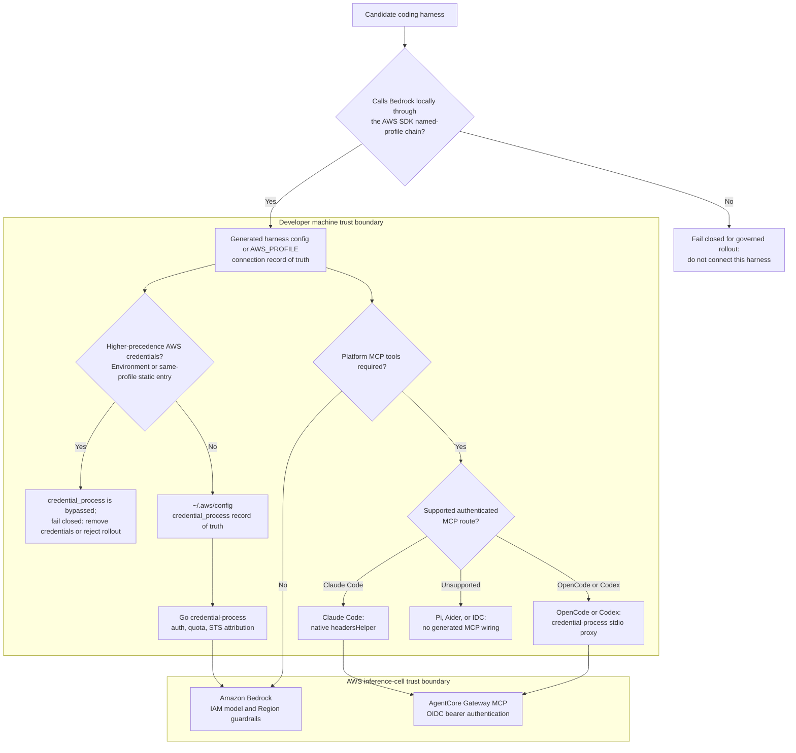

# Coding harnesses on Amazon Bedrock with the credential-process plug

This guidance is packaged for Claude Code, but its authentication core is
harness-agnostic. The credential-process binary emits standard
[AWS `credential_process` JSON](https://docs.aws.amazon.com/cli/latest/userguide/cli-configure-sourcing-external.html),
and the installer registers it as an AWS profile in `~/.aws/config`:

```ini
[profile gip]
credential_process = /home/user/gip/credential-process --profile gip
region = us-east-1
```

A coding harness that resolves credentials through the **AWS SDK default
chain**, such as OpenCode, ChatGPT Work and Codex, Pi, or Aider,
can use the sample's controls with **no
harness-specific auth work**. Generate ready-to-use configs with:

```bash
poetry run gip package --harnesses all        # or: opencode,codex,pi,aider
```

This writes `harnesses/<name>/` config files plus a `harnesses/README.md` into
the package output. The default (`--harnesses claude-code`, or omitting the
flag) produces exactly the same output as before.

## Architecture: one plug, N harnesses

Use this decision flow before adding a harness. A harness is governed only when
its Bedrock client resolves the installed AWS named profile; a vendor-hosted
inference path or private key store never reaches credential-process. AWS
provider precedence also matters: environment credentials or a static entry for
the same profile in `~/.aws/credentials` can be selected before the
`credential_process` entry in `~/.aws/config`.



## Controls shared by every harness on the plug

These controls are enforced **below the harness layer**, in the
credential-process binary and in IAM, so a harness can't opt out of them through its
own settings. The quota check runs in the standard binary, so a modified client that
calls AWS STS directly can skip it; IAM policy still applies
([How the controls work](HOW_IT_WORKS.md)):

| Control | Enforced where | Applies to |
|---|---|---|
| **OIDC SSO login** (browser flow, token cache, silent refresh) | credential-process binary | Every harness identically |
| **Quota enforcement** | credential-process checks quota **before vending credentials**; blocked users get no credentials at all | Every harness identically |
| **Per-user cost attribution** | STS session name embeds the user identity → `line_item_iam_principal` in CUR 2.0 (see [COST_ATTRIBUTION.md](COST_ATTRIBUTION.md)) | Every harness identically |
| **Model / region guardrails** | IAM policy on the assumed role (Anthropic-model allow-list via the `RestrictToAnthropicModels` parameter, opt-in OpenAI-on-bedrock-runtime via `AllowOpenAIModels`, region conditions) | Every harness identically |

## Per-harness setup

Model IDs in every generated config are the **same resolved cross-region
inference (CRIS) profile IDs** the packaged Claude Code settings receive
(resolved per tier for your deployment's CRIS geography, e.g.
`us.anthropic.claude-sonnet-4-5-20250929-v1:0`).

### OpenCode

Live-verified with OpenCode 1.18.18 on 2026-08-14: the generated config returned
`4`, and the web-search MCP proxy connected. Reference:
<https://opencode.ai/docs/providers/#amazon-bedrock>

Config file: `opencode.json` (project root, or `~/.config/opencode/opencode.json`).
The `amazon-bedrock` provider takes `options.region` and `options.profile`
(a named AWS profile — our managed profile); models are declared under
`provider.amazon-bedrock.models` keyed by model ID, and CRIS
inference-profile IDs are used directly as keys:

```json
{
  "$schema": "https://opencode.ai/config.json",
  "model": "amazon-bedrock/us.anthropic.claude-sonnet-4-5-20250929-v1:0",
  "provider": {
    "amazon-bedrock": {
      "options": { "region": "us-east-1", "profile": "gip" },
      "models": { "us.anthropic.claude-sonnet-4-5-20250929-v1:0": {} }
    }
  }
}
```

### ChatGPT Work and Codex (desktop app, CLI, IDE extension)

Live-verified with Codex CLI 0.160.0 on 2026-10-02 (sandbox account,
`eu-central-1` source Region, generic OIDC federation, [LV-18](LIVE_VALIDATION.md#lv-18-chatgpt-work-and-codex-on-bedrock-runtime)):
the generated config, unmodified, returned `bedrock-ok` on
`global.openai.gpt-6-sol` through the governed `credential_process` profile.
The Mantle provider was denied, the invocation log carried the user's
identity, server-side metering priced the tokens for that user, and an
exhausted budget refused credential issuance. The ChatGPT desktop app and IDE
extension read the same configuration layers per OpenAI's docs but were
**not live-tested** here. Reference (retrieved 2026-10-02):
<https://learn.chatgpt.com/docs/amazon-bedrock>

Deployment prerequisites:

| Setting | Why |
|---|---|
| `aws.allow_openai_models: true` (auth parameter `AllowOpenAIModels=true`) | Admits OpenAI models on bedrock-runtime ([ADR-0037](adr/0037-openai-models-on-bedrock-runtime.md)). Default `false` keeps the Anthropic-only policy. With IAM Identity Center the permission set decides instead ([IdC guide](providers/iam-identity-center-setup.md#chatgpt-work-and-codex-openai-models)). |
| `metering.enabled: true`, `metering.mode: max` | Codex emits no Claude Code OTEL metrics, so only server-side metering counts its usage. With `shadow`, a ChatGPT-Work-only user is never blocked (verified live). |
| `enable_finegrained_quotas: true` (for per-user or per-group budgets) | Otherwise one default limit applies to every user. |

Generated files (`gip package --harnesses codex`):

- `harnesses/codex/config.toml`, merged into `~/.codex/config.toml`:

  ```toml
  model_provider = "amazon-bedrock-runtime"
  web_search = "disabled"
  model = "global.openai.gpt-6-sol"   # us.openai.gpt-6-sol from us-* source Regions

  [model_providers.amazon-bedrock-runtime.aws]
  profile = "gip"
  region = "eu-central-1"
  ```

- `harnesses/codex/codex.env`, merged into `~/.codex/.env` for the ChatGPT
  desktop app and IDE extension (they may not inherit shell variables).
- `harnesses/codex/requirements.toml`, optional, for administrators (see the
  notes below).

Notes:

- **Use only the `amazon-bedrock-runtime` provider.** `amazon-bedrock` selects
  Mantle, which the governed role policy denies in every configuration because Mantle
  writes no invocation logs ([ADR-0022](adr/0022-mantle-metering-deferred-tripwire.md)).
  IAM Identity Center users run on the permission set instead, so add the deny there
  ([IdC guide](providers/iam-identity-center-setup.md#chatgpt-work-and-codex-openai-models)).
- **OpenAI models only.** ChatGPT Work and Codex do not run Claude models on
  Bedrock; the Claude CRIS IDs do not apply.
- **Data residency.** The model cards of the GPT-5.x and GPT-6.x models that
  ChatGPT Work uses list US Geo (`us.`) and Global
  (`global.`) profiles on bedrock-runtime, and some models also an India (`in.`)
  or GovCloud (`us-gov.`) Geo profile. From EU, AU or JP source Regions the only
  option is Global CRIS, which can route prompts to commercial Regions
  worldwide. The live `eu-central-1` call ran in `us-east-1`
  (`inferenceRegion` in the invocation log). Invocation logs and quota
  records stay in the deployment's Regions.
- **Model control is IAM.** With `AllowOpenAIModels=true`, every `openai.*`
  model the account can reach is admitted. The client-side model catalog
  (`model_catalog_json`) is not a security boundary and is not generated.
- **Optional admin `requirements.toml`.** `harnesses/codex/requirements.toml`
  enforces `model_provider = "amazon-bedrock-runtime"`,
  `allowed_login_methods = ["api"]` (blocks ChatGPT-account sign-in),
  `allowed_web_search_modes = []` (only `disabled`) and
  `[features] in_app_updates = false`. Users cannot override it. It is not
  installed automatically: deploy it to `/etc/codex/requirements.toml`
  (macOS, Linux), `%ProgramData%\OpenAI\Codex\requirements.toml` (Windows)
  or the macOS MDM key `requirements_toml_base64` in domain `com.openai.codex`.
  The login restriction is honored only in the system file or MDM, not in
  cloud-managed policy. Schema:
  <https://learn.chatgpt.com/docs/enterprise/managed-configuration> and the
  `requirements.toml` section of
  <https://learn.chatgpt.com/docs/config-file/config-reference> (retrieved
  2026-10-02). Codex CLI 0.160.0's app-server schema lists the same keys
  (`modelProvider`, `allowedLoginMethods`, `allowedWebSearchModes`,
  `featureRequirements`). Enforcement was **not live-tested**: that needs a
  system-wide file on the test machine.
- **No hosted web search** on Bedrock Runtime. The AgentCore web-search MCP
  stdio entry is still generated when web search is deployed (not live-tested
  with Codex 0.160.0).
- Unset `AWS_BEARER_TOKEN_BEDROCK`: Codex tries a Bedrock API key before the AWS
  SDK credential chain, which would bypass the governed profile.
- From GovCloud source Regions the generator leaves `model` unset: the default
  GPT-6 Sol has no GovCloud profile. Some models list a `us-gov.` Geo profile on
  their model card; set one manually after checking that card.

### Pi

Live-verified with Pi 0.73.1 and Claude Sonnet 4.5 on 2026-08-14. Sonnet 5 had
payload incompatibilities in this client; generated config now uses the
selected model rather than assuming Sonnet 5. Reference:
<https://pi.dev/docs/latest/providers#amazon-bedrock>

Pi has **no dedicated Bedrock config file**. Credentials come from the AWS SDK
chain ("Option 1: AWS Profile" — `export AWS_PROFILE=...`, optional
`AWS_REGION`, default `us-east-1`), and the provider/model are CLI flags:

```bash
export AWS_PROFILE=gip
export AWS_REGION=us-east-1
pi --provider amazon-bedrock --model us.anthropic.claude-sonnet-4-5-20250929-v1:0
```

CRIS inference-profile IDs are passed directly as `--model`; Pi auto-enables
prompt caching for Claude model IDs it recognizes. The package ships a
sourceable `pi-bedrock.env`.

### Aider

Live-verified with Aider 0.86.2 and Claude Sonnet 4.5 on 2026-08-14. Sonnet 5
had payload incompatibilities in this client; generated config now uses the
selected model. Reference: <https://aider.chat/docs/llms/bedrock.html>

Config file: `.aider.conf.yml` (project root or home directory), models named
via LiteLLM's `bedrock/<model-id>` scheme. Inference-profile-only models
**require** the CRIS Inference Profile ID (not the base model ID). AWS auth
via `AWS_PROFILE` + `AWS_REGION` environment variables or an `.env` file:

```bash
export AWS_PROFILE=gip
export AWS_REGION=us-east-1
aider --model bedrock/us.anthropic.claude-sonnet-4-5-20250929-v1:0
```

Aider may need `boto3` installed into its environment (`pipx inject aider-chat boto3`).

### Cline

Verified against: <https://docs.cline.bot/provider-config/aws-bedrock/cli-profile>
(retrieved 2026-07-08)

Cline's "AWS Bedrock" provider reads a named AWS profile (or the default
credential chain) from `~/.aws` — Cline's enterprise docs describe it as the
"standard AWS credential provider chain". Point it at the managed profile and it
can use SSO, quota, attribution, and IAM guardrails with no extra work:

1. In Cline settings, choose provider **AWS Bedrock**.
2. Select authentication **AWS Profile** and enter `gip`.
3. Set the region to your deployment's region and the model to a permitted CRIS
   profile ID (e.g. `us.anthropic.claude-sonnet-4-5-20250929-v1:0`).

No generated config ships for Cline (`--harnesses` does not include it); the
manual steps above are the integration.

### Continue

Verified against: <https://www.continue.dev/docs/customize/model-providers/top-level/bedrock>
(retrieved 2026-07-08)

Continue's `bedrock` provider authenticates via a named profile from `~/.aws`:

```yaml
models:
  - name: Claude via governed Bedrock
    provider: bedrock
    model: us.anthropic.claude-sonnet-4-5-20250929-v1:0
    env:
      region: us-east-1
      profile: gip
```

> **Caveat:** Continue's docs show profile-based auth; they do not explicitly
> mention `credential_process`-backed profiles. Profile resolution goes through
> the AWS SDK, which handles `credential_process` transparently, but run a
> one-user smoke test before fleet rollout. As with Cline, no generated config
> ships — the snippet above is the integration.

### Not currently covered by this sample: Cursor, Windsurf, Gemini CLI

Documented so security teams can decide how to handle these (all sources retrieved
2026-07-08):

| Harness | Why this sample doesn't cover it |
|---|---|
| **Cursor** | The CLI rejects Bedrock models ("Bedrock models are disabled" — [Cursor forum, 2026-02-25](https://forum.cursor.com/t/cli-support-for-aws-bedrock-integration/152865)). The IDE's BYOK-Bedrock option exists but uses static keys or an IAM role (with external ID) **assumed by Cursor's backend**, not the local credential chain ([Cursor API-keys docs](https://docs.cursor.com/advanced/api-keys)) — it would bypass credential-process entirely, so quota, session-name attribution, and the fail-closed vend gate never run. With BYOK-Bedrock, requests don't pass through this sample's controls; decide with your security team whether to allow it |
| **Windsurf** | Inference routes through Windsurf's service; no Bedrock / bring-your-own-credential-chain option in the official docs index ([docs.windsurf.com](https://docs.windsurf.com)) |
| **Gemini CLI** | No Amazon Bedrock provider as of 2026-07-08 ([google-gemini/gemini-cli#3454](https://github.com/google-gemini/gemini-cli/issues/3454), opened 2025-07-07) |

For the requirements a harness must meet to use this sample's controls, the
test is simple: **does it resolve Bedrock credentials through the AWS SDK
default chain / `~/.aws` profiles?** If yes (Cline, Continue, and the four
harnesses above), this sample covers it. If it ships its own key store or routes
inference through vendor servers, this sample doesn't cover it.

## Honest capability matrix

Authentication, quota, and IAM guardrails apply to every harness on the plug.
Features built on Claude Code's own client hooks don't. (The non-Claude-Code column applies
equally to Cline and Continue — they ride the same profile.)

| Capability | Claude Code | OpenCode / Codex / Pi / Aider |
|---|---|---|
| SSO login (OIDC browser flow) | ✅ credential-process | ✅ identical — same binary |
| Quota blocking at credential issuance | ✅ | ✅ identical — checked before creds are vended |
| Per-user CUR cost attribution (session name) | ✅ | ✅ identical |
| IAM model/region guardrails | ✅ | ✅ identical |
| Model inference with governed credentials | ✅ | ✅ OpenCode / Pi / Aider; ✅ ChatGPT Work / Codex on `amazon-bedrock-runtime` with `AllowOpenAIModels=true` (Mantle provider denied, see [ChatGPT Work and Codex](#chatgpt-work-and-codex-desktop-app-cli-ide-extension)) |
| **Per-user OTEL telemetry → solution dashboards** | ✅ emits OTEL metrics | ❌ do **not** feed the solution's dashboards |
| **Per-user usage visibility** | OTEL dashboards + CUR | Session-name CUR attribution; plus, when deployed, server-side metering from Bedrock invocation logs covers **all harnesses identically** ([design](designs/server-side-metering-design.md)). ChatGPT Work / Codex budgets require metering mode `max` |
| **Default model and optional model restriction via managed settings** | ✅ with `lock_default_model`, `managed-settings.json` (OS-managed, highest precedence) sets a default model, which is a default, not a lock. Adding `restrict_model_selection` restricts `/model` and `--model` to the model selected in `gip init` (Opus and Sonnet for opusplan) plus the Haiku-tier model, which background tasks use and users can also select, through `availableModels` and `enforceAvailableModels`; it needs Claude Code v2.1.175 or later. Both bind Claude Code only, and a local administrator can still edit the file | ❌ managed-settings is Claude-Code-only; these harnesses rely on the IAM `RestrictToAnthropicModels` allow-list (any permitted Anthropic model is selectable; with `AllowOpenAIModels=true`, ChatGPT Work / Codex can select any `openai.*` model) |
| **Admin-enforced client policy** | ✅ `managed-settings.json` | ChatGPT Work / Codex: optional generated `requirements.toml` pins the `amazon-bedrock-runtime` provider, API-only login, no hosted web search, no in-app updates (not live-tested); ❌ OpenCode / Pi / Aider |
| **Web search (AgentCore gateway MCP)** | ✅ native `headersHelper` (see [Platform tools](#platform-tools-mcp)) | ✅ OpenCode / Codex via the `--mcp-proxy` stdio shim; ❌ Pi / Aider (no MCP support upstream) |
| **Claude apps gateway** | ✅ optional gateway integration | ❌ Claude-Code-only; other harnesses keep direct Bedrock access |

Two practical consequences:

1. **Usage dashboards under-count if users adopt other harnesses** while only
   client OTEL is deployed. Session-name CUR attribution still captures their
   spend per user, and the
   [server-side metering design](designs/server-side-metering-design.md)
   closes the gap authoritatively for every harness (it meters Bedrock
   invocation logs, which no client can suppress).
2. **Model governance shifts from settings to IAM.** With `lock_default_model`,
   managed settings set Claude Code's default model, which is a default, not a
   lock. Adding `restrict_model_selection` restricts Claude Code's model
   selection through `availableModels`. That restriction binds Claude Code only,
   and a local administrator can still edit the file; the other harnesses can pick
   any model the IAM policy allows. If a hard model allow-list matters, enforce it in
   IAM (it already applies to every harness).

## Platform tools (MCP)

When the optional [web search stack](WEB_SEARCH.md) is deployed
(`web_search_enabled`, OIDC auth), `gip package` wires the AgentCore Gateway
MCP endpoint (`GatewayMcpEndpoint`, streamable HTTP, `Authorization: Bearer
<id_token>`) into every harness whose MCP client can carry it. The auth
primitive is the same everywhere: `credential-process --profile <name>
--get-mcp-auth-header` prints `{"Authorization":"Bearer <id_token>"}` without
ever opening a browser (cached token first, silent refresh_token exchange on a
miss).

| Harness | Mechanism | Generated artifact |
|---|---|---|
| **Claude Code CLI** | Native streamable HTTP + `headersHelper` (the installer-dropped `websearch-headers` wrapper) | Installer runs `claude mcp add-json agentcore-websearch -s user`; `gip-settings/mcp.json` is the distributable fallback |
| **Claude Desktop / CoWork** | `managedMcpServers` + `headersHelper` + `headersHelperTtlSec=900` | MDM `.mobileconfig` / `.reg` (see [COWORK_3P.md](COWORK_3P.md)) |
| **OpenCode** | stdio shim: `credential-process --mcp-proxy <url>` (`type:"local"` entry) | `harnesses/opencode/opencode.json` → `mcp.agentcore-websearch` |
| **Codex CLI** | stdio shim (`[mcp_servers.agentcore-websearch]` `command`/`args`) | `harnesses/codex/config.toml` |
| **Pi** | ❌ not supported — no MCP by design (extensions are Pi's escape hatch; the community `pi-mcp-adapter` can reuse the stdio shim entry) | docs pointer only |
| **Aider** | ❌ not supported — no MCP client upstream (Aider-AI/aider#2525 open) | docs pointer only |

### Setup per harness

- **Claude Code CLI:** run the installer. If the `claude` CLI is on PATH (and
  the installer is not running under `sudo`), the server is registered
  automatically at user scope; otherwise the installer prints the exact
  `claude mcp add-json` command to run once. Admins can instead distribute
  `gip-settings/mcp.json` as a project `.mcp.json` (users get a one-time
  approval prompt).
- **OpenCode / Codex:** run the installer **first** — it resolves the
  `__CREDENTIAL_PROCESS_PATH__` placeholder in the generated configs to the
  installed binary path — then copy the config per `harnesses/README.md`. Do
  not convert the OpenCode entry to `type:"remote"`: remote headers are static
  and OpenCode's automatic OAuth-on-401 opens a browser against a gateway that
  is not an OAuth authorization server.
- **Pi / Aider:** no wiring is generated; the per-harness sections in
  `harnesses/README.md` state the limitation honestly.

### Token TTL

The gateway validates the OIDC `id_token`, which typically expires after ~1
hour. No harness needs a long-lived token:

- **Claude Code** re-runs the `headersHelper` fresh on every connection and,
  as of v2.1.193, re-runs it and retries once on a 401/403 mid-session.
- **CoWork** re-invokes the helper every `headersHelperTtlSec` (900 s).
- **The `--mcp-proxy` shim** fetches the header per request and force-refreshes
  + retries once on a 401/403 from the gateway. If the browserless refresh is
  exhausted (no refresh_token), it fails closed with a JSON-RPC error and a
  non-zero exit — run any `credential-process` auth flow once to recover.

**IDC deployments get no MCP wiring** in any harness: the gateway's
`CUSTOM_JWT` authorizer validates OIDC id_tokens, and no harness MCP client
supports SigV4. The packaging output prints this skip explicitly.

## Relationship to `gip package`

- `--harnesses` accepts a comma-separated list (`opencode,codex,pi,aider`),
  `all`, or `claude-code` (default). It can also be persisted in the profile's
  `harnesses` field.
- Output lands in `harnesses/<name>/` inside the package directory, next to
  the installer. Users run the normal installer **first** (it creates the AWS
  profile and installs the binary), then apply their harness's config file per
  `harnesses/README.md`.
